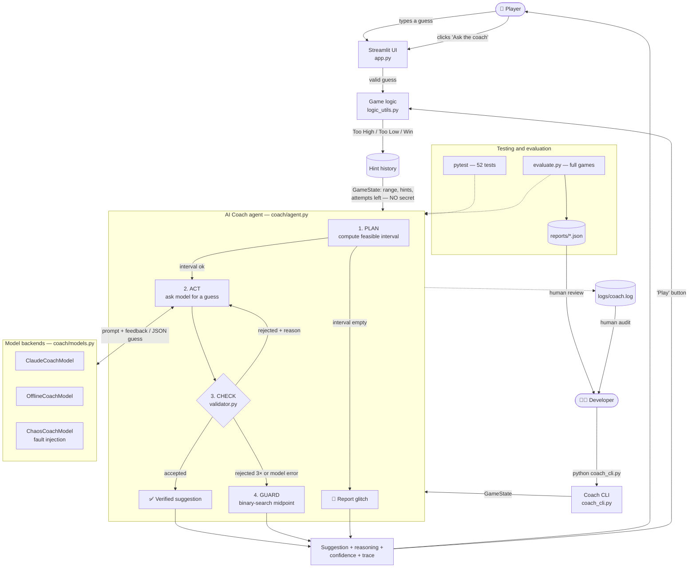

# 🎮 Glitchy Guesser + 🤖 AI Coach

**A number-guessing game with an agentic AI coach that checks its own advice
before it shows it to you, and notices when the game is lying.**

The coach is built on Claude. It reads the hints the game has given and
recommends the next guess. A deterministic validator checks every
recommendation against those hints. If the AI gets it wrong, the agent sends
the reason back and asks it to try again. If it still can't produce a valid
guess, a provably safe fallback takes over. If the hints contradict each other,
the coach refuses to guess and reports that the game is glitched.

Why it matters: people tend to trust an AI that sounds confident. This project
is a small, fully measurable example of the opposite approach. It treats
language-model output as a *proposal* and has code verify it before anyone
acts on it.

---

## 📜 Origin: the Module 1-3 project

This repo grew out of **Game Glitch Investigator: The Impossible Guesser**
(CodePath AI110, Modules 1-3). That project was a Streamlit number-guessing
game an AI had "written and abandoned". It was deliberately full of bugs:
inverted hints, a secret compared as a *string* on every other turn, a New Game
button that killed the app, and scoring that rewarded wrong answers. My job was
to find and fix those bugs, refactor the logic into a testable module, and
prove each fix with regression tests. I documented 7 bugs and grew the test
suite from 3 to 19. The full write-up of that work is still in
[reflection.md](reflection.md).

This version keeps the fixed game and adds an AI system on top of it. The
original bug hunt also inspired the coach's most interesting feature: glitch
detection.

---

## 🏗️ Architecture overview

Source: [diagrams/architecture.mmd](diagrams/architecture.mmd). GitHub renders it below.



**How data flows.** The player's guesses go through the game logic, which
produces hints (`Too High` / `Too Low` / `Win`). When the player asks for help,
the app builds a `GameState` containing the range, the hints and the attempts
left. **The secret is not in it.** The `CoachAgent` then runs four steps:

| Step | Component | What happens |
|------|-----------|--------------|
| 1. Plan | `coach/validator.py` | Computes the interval of secrets still consistent with every hint. If it is empty, the hints contradict each other, so the coach reports a **glitch** and does not call the model. |
| 2. Act | `coach/models.py` | Asks the model for a guess. Claude gets only the raw hints (not the computed interval), so it has to reason, and replies in schema-constrained JSON: `guess`, `reasoning`, `confidence`. |
| 3. Check | `coach/validator.py` | Rejects anything that is not an integer, repeats a guess, or contradicts a hint. The rejection reason goes back to the model and it tries again (up to 3 tries). |
| 4. Guard | `coach/agent.py` | If every try fails, or the API errors, refuses, or times out, the coach falls back to the binary-search midpoint. That move is always valid and keeps a win guaranteed. |

**Where humans and testing check the AI.** The player sees the reasoning, a
confidence score, a badge saying whether the guess is *verified* or a
*fallback*, and an expandable trace of every plan/act/check step. Every step is
also written to `logs/coach.log`. `pytest` covers the logic, and `evaluate.py`
plays hundreds of complete games and writes JSON reports for a human to review.

---

## ⚙️ Setup

Requires Python 3.10+.

```bash
git clone https://github.com/aly-hegazy1/applied-ai-system-project.git
cd applied-ai-system-project
python -m venv .venv && source .venv/bin/activate   # optional but recommended
pip install -r requirements.txt
```

**Optional: turn on the Claude backend.** Without a key, everything runs in
offline mode with a rules-based coach, so the app, CLI, tests and evaluator all
work with no credentials.

```bash
export ANTHROPIC_API_KEY=sk-ant-...      # the app then defaults to Claude
```

**Run it:**

```bash
python -m streamlit run app.py           # the game + AI Coach panel
python coach_cli.py --hints 50:high 25:low   # one suggestion in the terminal
python -m pytest                         # 52 tests, no network needed
python evaluate.py --suite               # reliability report → reports/
python evaluate.py --model claude --games 9  # measure the real Claude coach
```

---

## 💬 Sample interactions

All of the output below is copied from real runs. These runs use the offline
and fault-injection backends, so anyone can reproduce them exactly without an
API key. Run the same commands with `--model claude` to see Claude's own
wording; the agent loop and validator behave identically.

**1. Mid-game advice.** Range 1-100; 50 was too high and 25 too low.

```
$ python coach_cli.py --range 1 100 --hints 50:high 25:low --attempts-left 6
Agent trace:
  PLAN: range 1-100, 2 hint(s), 6 attempt(s) left -> secret is in 26-49 (24 possible)
  ACT #1: offline proposed 37 (confidence 1.00)
  CHECK #1: accepted - Consistent with every hint so far.

Suggested guess : 37
Reasoning       : The secret must be between 26 and 49; 37 splits that range in half.
Source          : model (offline)
Confidence      : 1.00
Win guaranteed  : True
```

**2. The AI misbehaves and the guardrails catch it.** The chaos backend is
forced to fail every time (`--fault-rate 1.0`). Its first answer is not a
number, and its second is an error. Neither reaches the player.

```
$ python coach_cli.py --model chaos --fault-rate 1.0 --range 1 20 --hints 10:low
Agent trace:
  PLAN: range 1-20, 1 hint(s), 8 attempt(s) left -> secret is in 11-20 (10 possible)
  ACT #1: chaos(offline, p=1.0) proposed 'fifty' (confidence 0.90)
  CHECK #1: rejected - Guess 'fifty' is not an integer.
  ACT #2: chaos(offline, p=1.0) failed: Injected fault: backend returned nothing usable.
  FALLBACK: using binary-search midpoint 15

Suggested guess : 15
Reasoning       : The AI's suggestion could not be verified, so this is the safe default: 15 is the midpoint of the 11-20 range that is still possible.
Source          : fallback (chaos(offline, p=1.0))
Confidence      : n/a
Win guaranteed  : True
```

**3. The game lies and the coach notices.** "50 is too high" and "60 is too
low" cannot both be true. The coach refuses to guess instead of picking one.

```
$ python coach_cli.py --range 1 100 --hints 50:high 60:low
Agent trace:
  PLAN: range 1-100, 2 hint(s), 8 attempt(s) left -> secret is in 61-49 (0 possible)
  GLITCH: no number is consistent with every hint; refusing to guess

GLITCH DETECTED: These hints contradict each other - no secret could produce all of them. The game's feedback is wrong, so any guess would be a coin flip.
```

**4. Bad input is rejected with a clear message.**

```
$ python coach_cli.py --hints 5:sideways
coach_cli.py: error: argument --hints: bad hint '5:sideways': use GUESS:high or GUESS:low, e.g. 50:high
```

**In the app.** Clicking **Ask the coach for a hint 💡** shows, for example,
*"**Try 75.** The secret must be between 51 and 100; 75 splits that range in
half."*, plus a `✅ verified suggestion` badge and the remaining range. A
**Play 75 ▶️** button submits that guess. I scripted the app with Streamlit's
`AppTest` to play a whole Normal round using only the coach's suggestions. It
won on attempt 7 with secret 52 (50 → 75 → 62 → 56 → 53 → 51 → 52), which is
within the 7-guess worst case for 1-100.

---

## 🧪 Testing and reliability

### Summary

**52 of 52 tests pass. Across 120 evaluated games the coach never played an
invalid guess.** That holds even when the model was wrong 60% of the time: the
validator rejected 119 bad suggestions, retries recovered 44 turns, and the
fallback covered the other 50. The one weakness is the deliberately glitched
game. The coach caught the lying hints in only **2 of the 4** games where the
game lied. In the other two the lies did not collide until after the attempts
ran out (details in [model_card.md](model_card.md)).

### Automated tests: `python -m pytest`

```
$ python -m pytest
....................................................                     [100%]
52 passed in 1.22s
```

The complete verbose output is in [reports/pytest_output.txt](reports/pytest_output.txt).

| Test file | Tests | What it covers |
|-----------|-------|----------------|
| `tests/test_game_logic.py` | 19 | The original Module 1-3 bug regressions: hint direction, type safety, scoring, range enforcement, winnability |
| `tests/test_coach.py` | 33 | Interval math, validator rules, retry-with-feedback, fallback, glitch detection, the trace, the Claude adapter with a fake client (request shape, JSON parsing, refusal handling, confidence clamping), a real SDK client pointed at a dead port (must fall back, not crash), and end-to-end evaluation thresholds |

### Evaluation harness: `python evaluate.py --suite`

The harness plays complete games against the real game logic, cycling
Easy/Normal/Hard with seeded secrets so the results are reproducible.
`invalid_guesses_played` is audited independently of the agent's own
validator. It replays the *true* hints, so a bug in the validator would still
show up there.

```
$ python evaluate.py --suite
```

| Metric | Offline coach | Chaos, 30% faults | Chaos, 60% faults | Glitched game (Bug 2 replayed) |
|--------|--------------:|------------------:|------------------:|-------------------------------:|
| Games | 30 | 30 | 30 | 30 |
| Win rate | **100%** | **100%** | **100%** | 86.7% |
| Avg guesses to win | 5.2 | 5.2 | 5.2 | 5.04 |
| Wins within binary-search bound | 100% | 100% | 100% | 100% |
| Suggestions valid on first try | 100% | 67.9% | 39.7% | 98.8% |
| Suggestions rejected by validator | 0 | 57 | 119 | 0 |
| Turns recovered by retry | 0 | 31 | 44 | 0 |
| Turns that used the fallback | 0 | 19 | 50 | 0 |
| **Invalid guesses actually played** | **0** | **0** | **0** | **0** |
| Guesses misled by false hints | 0 | 0 | 0 | 20 |
| Games where the game lied | 0 | 0 | 0 | 4 |
| Glitch detected in those games | – | – | – | 2 of 4 |
| False glitch alarms | 0 | 0 | 0 | 0 |

Raw output: [reports/eval_suite_output.txt](reports/eval_suite_output.txt). The
JSON reports in [reports/](reports/) include every guess of every game.

**Measuring Claude itself:** `python evaluate.py --model claude --games 9`
produces the same table for the live model. The first-try-valid rate and the
average confidence are the interesting numbers there. I did not have an API
key while I wrote this README, so no Claude numbers are reported here. I'd
rather leave the column out than make it up.

### Logging and guardrails

| Guardrail | Where | Behavior |
|-----------|-------|----------|
| Coach never sees the secret | `GameState` has no secret field (asserted by a test) | Advice cannot leak the answer |
| Output validation | `validator.validate_suggestion` | Non-integers, repeats and contradicted numbers are rejected with a reason |
| Retry with feedback | `CoachAgent.suggest` | Up to 3 model calls; each retry includes why the last one failed |
| Safe fallback | `CoachAgent.suggest` | Binary-search midpoint whenever the model can't be verified |
| API failures | `ClaudeCoachModel.propose` | Auth, rate-limit, status, connection, refusal and max-token stops become `CoachModelError` and lead to the fallback, never a crash |
| Structured output | JSON schema via `output_config` | Malformed JSON is still caught; out-of-range confidence is clamped and logged |
| Contradiction detection | `feasible_interval` | Lying hints are reported instead of guessed through |
| Audit log | `logs/coach.log` | Every PLAN / ACT / CHECK / FALLBACK line, with timestamps and WARNING on rejections |

Sample from `logs/coach.log`:

```
2026-11-24 16:32:02,405 INFO    coach.agent: PLAN: range 1-20, 1 hint(s), 5 attempt(s) left -> secret is in 1-9 (9 possible)
2026-11-24 16:32:02,405 INFO    coach.agent: ACT #1: offline proposed 5 (confidence 1.00)
2026-11-24 16:32:02,405 INFO    coach.agent: CHECK #1: accepted - Consistent with every hint so far.
```

---

## 🧭 Design decisions and trade-offs

- **Agentic workflow, not just one API call.** A single prompt that asks for
  a guess would look like it works, but nothing would check it. The
  plan → act → check → retry loop is what makes the AI's output safe to act
  on, and it is what the evaluation measures.
- **The validator is the source of truth, not the model.** Correctness here is
  something code can decide, so I let code decide it. The model's job is the
  part worth having a model for: explaining the move in plain language.
- **Claude gets the raw hints, not the computed interval.** Handing it the
  answer range would make the check pointless. With raw hints the model does
  the reasoning and the validator independently verifies it.
- **Offline backend as a first-class mode.** The project must run for a
  reviewer without an API key, and tests must not depend on the network or
  cost money. The trade-off is that the offline coach is "perfect", so the
  chaos backend exists to exercise the guardrails honestly.
- **Fault injection over hoping for failures.** Waiting for Claude to make
  mistakes would give a guardrail test that rarely fires. `ChaosCoachModel`
  produces every failure type on demand, with a seed, so "the guardrails hold"
  is a measured claim.
- **Don't retry a broken backend.** A rejected *answer* is retried with
  feedback, but an API *error* goes straight to the fallback. The SDK already
  retries transient errors, and the player shouldn't wait through three
  timeouts.
- **Low effort setting.** Choosing a number from hints is a small reasoning
  task, and a hint should feel instant. The Claude call uses
  `effort: "low"`, and server-side refusal fallback is enabled.

---

## 🪞 Reflection

The main lesson is that "the AI's answer" and "the system's answer" should not
be the same thing. In Modules 1-3 the scariest bug was code that quietly
caught an error and returned a confident wrong answer. Building the coach was
the same lesson from the other side: I designed for the model being wrong, put
a checker between it and the user, and then *measured* whether the checker
held by breaking the model on purpose. The glitch-mode result also kept me
honest. A coach that trusts consistent lies can be led astray, and saying that
plainly is more useful than a 100% headline.

The graded responsible-AI reflection (limitations, misuse, surprises, and how I
worked with AI) is in **[model_card.md](model_card.md)**.

---

## 📁 Project structure

```
app.py                 Streamlit game + AI Coach panel
logic_utils.py         Pure game logic (from Modules 1-3)
coach/
  agent.py             Plan → act → check → retry → fallback loop
  models.py            Claude, offline and chaos backends; prompt + schema
  validator.py         Feasible-interval math and suggestion validation
  logging_config.py    File logging to logs/coach.log
coach_cli.py           Ask the coach from the terminal
evaluate.py            Reliability harness (full games, JSON reports)
tests/                 52 pytest tests
diagrams/architecture.mmd  System diagram (Mermaid source)
assets/                Images for the README
reports/               Evaluation and test output
model_card.md          Limitations, ethics, AI collaboration
reflection.md          Original Module 1-3 bug-hunt reflection
```
